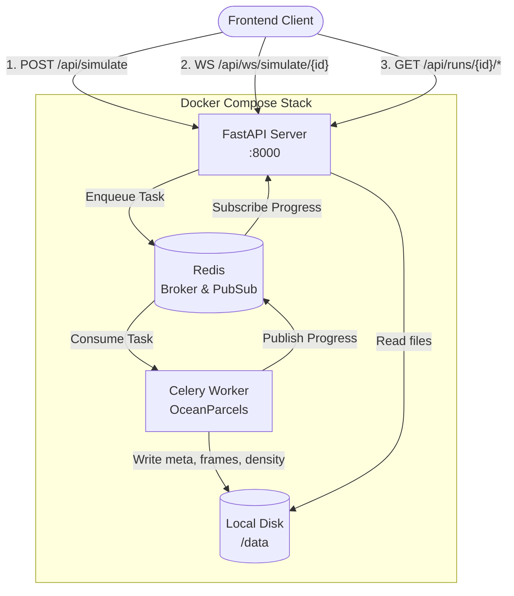

# OceanFlow — Backend

OceanFlow is a fast, scalable backend for the Ocean Plastic Transport Tracker. It leverages FastAPI for the REST and WebSocket APIs, Celery with Redis for asynchronous simulation task queuing, and OceanParcels to compute particle trajectories based on Copernicus Marine data. The backend serves high-density binary outputs (both raw particle coordinates and gridded heatmaps) directly to the frontend for real-time WebGL visualization.

---

## Architecture



---

## Quick Start

1. **Start the stack**
   ```bash
   docker-compose up --build -d
   ```

2. **Verify it is running**
   ```bash
   curl http://localhost:8000/api/health
   # {"status":"ok","parcelsVersion":"3.0.5","runCount":1}
   ```

3. **Submit a simulation**
   ```bash
   curl -X POST http://localhost:8000/api/simulate \
     -H "Content-Type: application/json" \
     -d '{
       "region":    {"west":-160,"east":-120,"south":20,"north":50},
       "time":      {"start":"2024-01-01T00:00:00Z","end":"2024-01-08T00:00:00Z","timeStepHours":6},
       "particles": {"count":500,"maxAgeDays":30,"windagePercent":1.5,"diffusionM2PerS":50,"beachingEnabled":false}
     }'
   # {"runId": "abc123...", "status": "pending"}
   ```

4. **Listen to WebSocket (using wscat or similar)**
   ```bash
   wscat -c ws://localhost:8000/api/ws/simulate/abc123...
   ```

---

## API Reference

| Method | Path | Description |
|---|---|---|
| `GET` | `/api/health` | Liveness and active run count |
| `GET` | `/api/runs` | List all available runs |
| `GET` | `/api/runs/{id}/meta` | Returns `meta.json` for a run |
| `GET` | `/api/runs/{id}/frames/{n}` | Returns binary particle frame (`n.bin`) |
| `GET` | `/api/runs/{id}/density/{n}` | Returns binary density grid frame (`n.bin`) |
| `HEAD` | `/api/runs/{id}/frames/{n}` | Check existence and Content-Length of a frame |
| `HEAD` | `/api/runs/{id}/density/{n}` | Check existence and Content-Length of a density frame |
| `POST` | `/api/simulate` | Enqueue a simulation task. Returns `202 Accepted` |
| `GET` | `/api/simulate/{id}/status` | Poll run status (`pending`, `running`, `complete`, `failed`) |
| `DELETE`| `/api/runs/{id}` | Recursively delete a complete or failed run |
| `WS` | `/api/ws/simulate/{id}` | Real-time WebSocket feed for simulation progress |

*All non-2xx API errors follow a standardized JSON format: `{"error": {"code": "...", "message": "..."}}`*

---

## Data Contract

All simulation data is stored in the `backend/data/runs/{runId}/` directory.

### `meta.json`
Contains all configuration, timing, bounding boxes, and grid metadata needed by the frontend.
```json
{
  "schemaVersion": 1,
  "generatedAt": "2024-02-15T12:00:00Z",
  "startDate": "2024-01-01T00:00:00Z",
  "timeStepHours": 6,
  "frameCount": 28,
  "particleCount": 500,
  "sources": [...],
  "bounds": {"west": -160, "east": -120, "south": 20, "north": 50},
  "heatmapGrid": {"cols": 720, "rows": 360}
}
```

### Particle Frames (`frames/{n}.bin`)
Every file is exactly `particleCount × 19` bytes, structured as little-endian C-structs.

| Offset | Type | Size | Field |
|---|---|---|---|
| 0 | `float32` | 4 B | longitude |
| 4 | `float32` | 4 B | latitude |
| 8 | `float32` | 4 B | speed (m/s) |
| 12 | `float32` | 4 B | age (days) |
| 16 | `int16` | 2 B | sourceIndex |
| 18 | `uint8` | 1 B | alive (0/1) |

### Density Heatmaps (`density/{n}.bin`)
Every file is exactly `heatmapGrid.cols × heatmapGrid.rows × 4` bytes.
- Format: `float32` array in row-major (C-contiguous) order.
- Top-left (Row 0, Col 0) corresponds to the North-West corner.
- Values represent normalized particle densities.
- Served with `X-Grid-Cols` and `X-Grid-Rows` headers for easy `Float32Array` ingestion in WebGL.

---

## Development

Requires Python 3.11.

```powershell
cd backend
.venv\Scripts\Activate.ps1

# Start API (auto-reloading)
python -m uvicorn src.api.main:app --port 8000 --reload

# Start Celery Worker (requires Redis on port 6379)
celery -A src.worker.celery_app worker --loglevel=info --concurrency=1

# Run tests
pytest tests/ -v
```

### Useful Scripts
- `scripts/07_cleanup_old_runs.py`: Delete old run artifacts to reclaim disk space (run with `--older-than-days`).
- `scripts/08_smoke_test.py`: Full end-to-end integration and liveness test.
- `scripts/06_backfill_density.py`: Recompute density frames for older runs.

---

## Deployment

OceanFlow is designed to be deployed as a multi-container Docker Compose stack.
Ensure `DATA_DIR` is mounted to a persistent volume so runs survive container restarts.

Production environment variables should be defined in a `.env` file based on `.env.example`.
Rate limiting (`RATE_LIMIT_PER_MINUTE`) is handled in-memory by default. For distributed setups, move the token bucket to Redis.

---

## Troubleshooting

- **`503 Service Unavailable` on Simulation Submit**: The Celery broker (Redis) is down or unreachable. Verify the `REDIS_URL`.
- **`429 Too Many Requests`**: You have hit the `MAX_CONCURRENT_SIMULATIONS` limit. Wait for the active run to finish or fail.
- **WebSocket Drops Immediately**: Verify the `run_id` exists. Invalid or missing runs close the connection with code `1008`.
- **Worker Hangs or OOMs**: OceanParcels can consume significant memory for large particle counts (>> 100k) over long durations. Constrain bounds and particle counts via API validation.

## Known Limitations

- Real-time density streaming (sending heatmap grids via WebSockets) is unsupported due to payload size. Heatmaps are read-only REST endpoints fetched post-simulation or progressively by the frontend.
- Rate limiting is currently in-memory per-worker process.
- Active run limits are enforced by counting `DONE`/`FAILED` markers on disk, requiring a shared volume between API and Worker.
